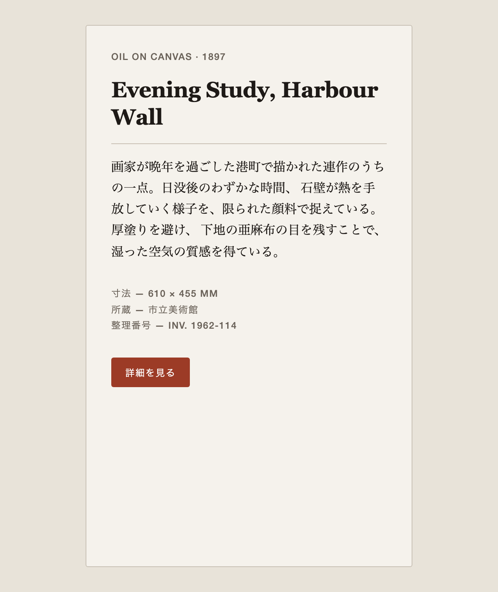
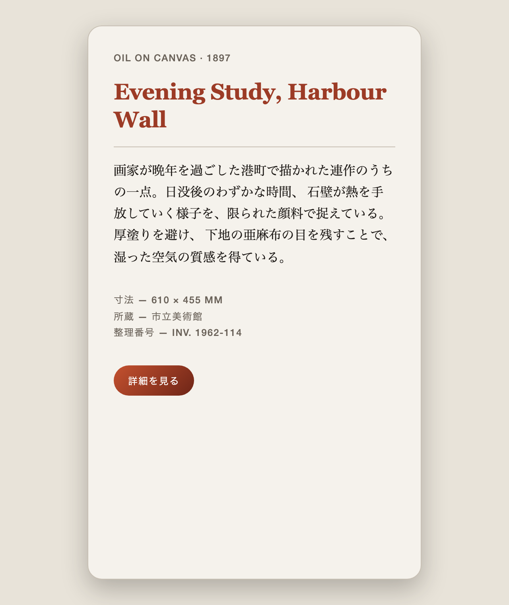
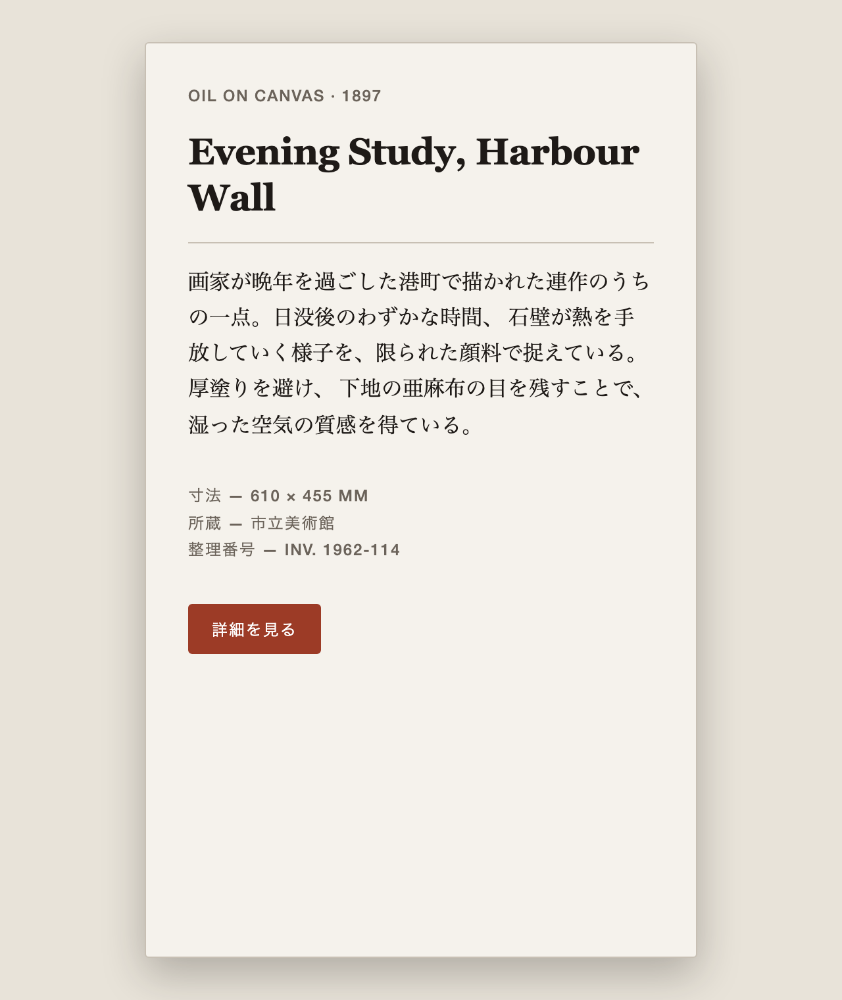

# DESIGN.md 実践ガイド

**DESIGN.md** — コーディングエージェントにビジュアルアイデンティティを永続的に持たせるためのファイル形式。その構造・書き方・落とし穴を、実測にもとづいて日本語で解説します。

チームで DESIGN.md を書き、レビューし、共同開発できる状態を作ることを目的にしています。

**解説記事（Zenn）: [DESIGN.mdを置くと、どこまで「いい感じ」になるのか — 74件を測って確かめた](https://zenn.dev/ait/articles/google-design-md-measured)**

[](https://github.com/BoxPistols/design-md-docs/actions/workflows/lint.yml)
[](LICENSE)

> 対象バージョン: フォーマット `alpha` / CLI [`@google/design.md`](https://www.npmjs.com/package/@google/design.md) `v0.4.0`
> 本家: [google-labs-code/design.md](https://github.com/google-labs-code/design.md)

---

## 分かったこと

1. **実物の DESIGN.md は2つの流派に分かれる。** [awesome-design-md](https://github.com/VoltAgent/awesome-design-md) 掲載の74件のうち64件はトークン中心のスキーマ型、10件は frontmatter を持たない散文型。スキーマ型のトークン比率は 48.1〜68.2% で、公式サンプル3件（77.3〜80.7%）とは1件も重ならない。→ [docs/03](docs/03-two-styles.md) / [`tools/measure.py`](tools/measure.py)
2. **仕様どおりに書いても、警告なし・終了コード0で値が消える箇所がある。** 素の数値、`components` 以外の壊れた参照、一部の色記法など、計7項目を CLI v0.4.0 で再現し、CI での検出方法を添えた。→ [docs/05](docs/05-pitfalls.md) / [`.github/workflows/lint.yml`](.github/workflows/lint.yml)
3. **実装が Don't を守っているかは、決定的チェッカと LLM judge を分けると判定できる。** computed style を見るチェッカは3実装で誤検出・見逃しともゼロ。スクリーンショットだけを見る LLM judge は判定可能な12項目すべて正解し、画像から分からない font-weight は3枚とも `undetermined` と答えた。→ [docs/07](docs/07-machine-verification.md) / [`tools/probe.mjs`](tools/probe.mjs)

同じカード UI を、DESIGN.md の Don't（アクセント色の文字・Bold・角丸・影・グラデーション）に対して3通り実装したもの（[`sandbox/`](sandbox/)）:

<table>
<tr>
<th>A: 準拠</th>
<th>B: 5項目すべて違反</th>
<th>C: Bold と影のみ違反</th>
</tr>
<tr>
<td></td>
<td></td>
<td></td>
</tr>
<tr>
<td>チェッカ: 0件</td>
<td>チェッカ: 6件（V1〜V5）</td>
<td>チェッカ: 2件（V2, V4）</td>
</tr>
</table>

A と C の見出しは font-weight 600 と 800 で、画面上はほぼ同じに見えます。この違いは CSS からしか取れません（[docs/07](docs/07-machine-verification.md)）。

---

## DESIGN.md を30秒で

```md
---
name: Heritage
colors:
  primary: "#1A1C1E"
  tertiary: "#B8422E"
typography:
  h1:
    fontFamily: Public Sans
    fontSize: 3rem
---

## Overview

Architectural Minimalism meets Journalistic Gravitas.
高級マット紙の質感 — 上質なブロードシートか、現代的なギャラリー。

## Colors

高コントラストのニュートラルと、単一のアクセントカラーに根ざしたパレット。

- **Primary (#1A1C1E):** 見出しと本文のための深いインク。
- **Tertiary (#B8422E):** "Boston Clay" — インタラクションを駆動する唯一の色。
```

**YAML frontmatter が機械可読なトークン、Markdown 本文が人間可読な根拠。**
エージェントはこの1ファイルを読むだけで、セッションをまたいでも同じ視覚言語で UI を生成できます。

---

## 読む順

| # | ドキュメント | 内容 |
|:--|:--|:--|
| 1 | [DESIGN.md とは何か](docs/01-what-is-design-md.md) | 位置づけ。何を解決し、何ではないか |
| 2 | [構造リファレンス](docs/02-structure.md) | スキーマ・セクション・型・`{参照}` 記法 |
| 3 | [2つの流派と選び方](docs/03-two-styles.md) | **実物74件の実測**。どちらの型で書くか |
| 4 | [書き方ガイド](docs/04-writing-guide.md) | 良い DESIGN.md の条件。レビュー観点 |
| 5 | [落とし穴](docs/05-pitfalls.md) | **仕様どおりに書くと壊れる箇所**。実測済み |
| 6 | [デザイナー不在の組織での運用](docs/06-orgs-without-designers.md) | CSS を書ける人がいない組織で、何が効いて何が効かないか |
| 7 | [実装が仕様を守っているか機械で判定する](docs/07-machine-verification.md) | **実験記録**。決定的チェッカと LLM judge を並走させて測った |

はじめての人は 1 → 3 → 4 の順が早いです。2 と 5 は書きながら引く辞書として使ってください。

**組織にデザイナーがいない場合は 6 を先に読んでください。** 推奨する始め方が変わります（トークンを書かない「散文のみ」の型から入る）。

---

## クイックスタート

```bash
# テンプレートをコピー
cp templates/DESIGN.md ./DESIGN.md

# 検証
npx @google/design.md lint DESIGN.md

# Tailwind v4 のテーマとして出力
npx @google/design.md export --format css-tailwind DESIGN.md > theme.css
```

> **Windows** では `.md` 拡張子がファイル関連付けと衝突するため、`designmd` エイリアスを使ってください。
> `npx -p @google/design.md designmd lint DESIGN.md`

---

## このガイドの特徴

一次資料の要約ではなく、**実際に測って確かめたこと**を書いています。

- **[実物74件の統計](docs/03-two-styles.md)** — [VoltAgent/awesome-design-md](https://github.com/VoltAgent/awesome-design-md) の実在する DESIGN.md（airbnb, apple, figma, nike, notion, spotify, tesla …）を機械的に測定。「2つの流派が存在する」「仕様外セクションが過半数に定着している」といった事実は、この測定から出ています。測定スクリプトは [`tools/measure.py`](tools/measure.py) に同梱しているので、誰でも再現できます。
- **[実装との差分](docs/05-pitfalls.md)** — 仕様書どおりに書くと**黙って値が消える**箇所が実在します。全項目を CLI v0.4.0 で再現し、回避策を添えました。

---

## リポジトリ構成

```
docs/         解説（上表）
templates/    出発点にできる DESIGN.md
sandbox/      実験環境（docs/07 の素材。3つの実装バリアントとスクショ）
tools/        実測・判定スクリプト
              measure.py  … 実物74件の統計（docs/03 の再現）
              shoot.mjs   … スクリーンショット
              probe.mjs   … 決定的チェッカ（docs/07 の再現）
```

---

## 貢献

誤り・追記の指摘は Issue か Pull Request でお願いします。

**事実の記述には出典を添えてください。** 一次資料（`docs/spec.md` / `PHILOSOPHY.md`）の該当行、または再現できるコマンドのどちらかです。このガイドの価値は「測って確かめた」ことにあるので、そこは守りたいところです。

---

## ライセンス

本ガイドの文章・図表・スクリプトは [**CC BY 4.0**](LICENSE)（クリエイティブ・コモンズ 表示 4.0 国際）で提供します。**帰属表示さえあれば、翻訳・改変・商用利用を含めて自由に使えます。**

引用部分の権利は各原典に帰属します。

## 免責

DESIGN.md フォーマットおよび `@google/design.md` は Google LLC のプロジェクトであり、**本リポジトリは非公式の解説資料**です。Google LLC とは無関係で、同社による承認・後援を受けたものではありません。

フォーマットは `alpha` 段階のため、記述が実装に追いつかなくなる可能性があります。各ドキュメントの冒頭に検証時点のバージョンを明記しています。
