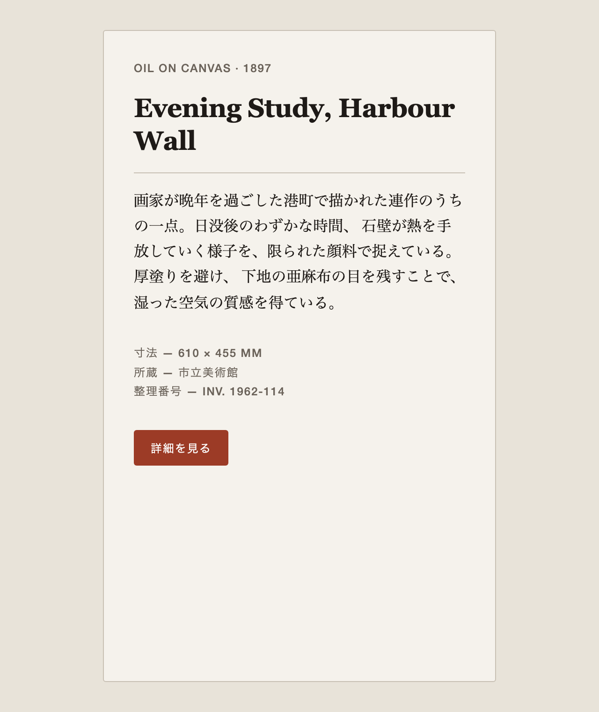
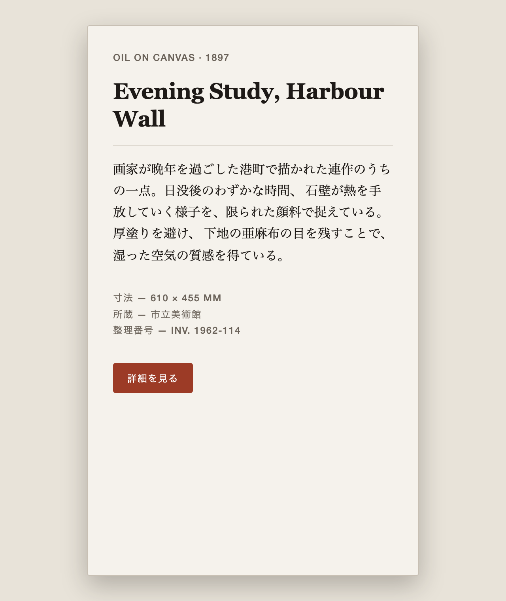

# 実装が仕様を守っているか、機械で判定する

> 実験日: 2026-08 / CLI `@google/design.md@0.4.0`
> 実験環境は [`sandbox/`](../sandbox/)、判定器は [`tools/probe.mjs`](../tools/probe.mjs)。再現手順は末尾。

[落とし穴](05-pitfalls.md) で見たとおり、`lint` はトークンしか見ません。この章は**その上に何を足せるか**を、実際に作って測った記録です。

---

## 問題設定

**11個のリントルールのうち、Markdown 本文に触れるのは `section-order` の1つだけ**で、それも見出しの並び順しか見ません。`export` も散文を捨てます。

一方、仕様自身は「散文こそが本体である」と言っています。

> **この形式は、自分が最重要と主張する部分を検証する手段を持っていません。**

念のため書いておくと、これは Google の落ち度ではありません。[公式アナウンス](https://blog.google/innovation-and-ai/models-and-research/google-labs/stitch-design-md/)が検証能力として名指ししているのは WCAG だけです。

> AI agents can know exactly what a color is for, and **can validate their choices against WCAG accessibility rules**.

**主張は正確で控えめです。** 問題は、使う側が「lint が通った」を「大丈夫」と読んでしまうことの方にあります。

---

## 実験デザイン

### 素材

[`sandbox/DESIGN.md`](../sandbox/DESIGN.md) — 「美術館の展示図録」を参照したデザインシステム。`Do's and Don'ts` に**視覚的に検証可能な Don't を5つ**置いてあります。

| | Don't |
|:--|:--|
| **V1** | アクセント色 `#9C3B26` を文字に使わない（ボタンの背景にのみ宿る） |
| **V2** | Bold（font-weight 700 以上）を使わない。最大 600 |
| **V3** | 角丸を 3px より大きくしない |
| **V4** | ドロップシャドウを使わない |
| **V5** | グラデーションを使わない |

### 3つの実装バリアント

同じカード UI を3通り実装します。差分は違反だけです。

| | ファイル | 違反 |
|:--|:--|:--|
| **A** | [`a-compliant.html`](../sandbox/variants/a-compliant.html) | **なし**（誤検出テスト用） |
| **B** | [`b-all-violations.html`](../sandbox/variants/b-all-violations.html) | V1〜V5 **すべて** |
| **C** | [`c-partial.html`](../sandbox/variants/c-partial.html) | **V2 と V4 のみ**（一番現実的） |

[`sandbox/base.css`](../sandbox/base.css) が準拠実装を持ち、各バリアントは**違反だけを上書き**します。値はすべて `design.md export` が生成した CSS 変数を参照します。

### 判定器を2つ並走させる

| | 実装 | 入力 |
|:--|:--|:--|
| **決定的チェッカ** | [`tools/probe.mjs`](../tools/probe.mjs) | computed style |
| **視覚 judge** | LLM subagent | **スクリーンショットのみ** |

**judge は盲検です。** ファイル名を `sample-1/2/3` に変え、順序も入れ替え、画像内のラベルも消しました。そして選択肢に `undetermined`（画像からは判断できない）を用意し、**棄権を推奨する**と明記しました。

---

## 途中で実験設計が壊れた

スクリーンショットを撮った時点で、**A（font-weight 600）と C（800）のタイトルが視覚的にほぼ同一**であることに気づきました。

<table>
<tr><th>A（600・準拠）</th><th>C（800・違反）</th></tr>
<tr>
<td></td>
<td></td>
</tr>
</table>

Georgia には 600 も 800 も無いため、ブラウザが**両方とも合成ボールドで描く**のです。C には影（V4）が出ているので違いは分かりますが、**タイトルの太さだけを見て V2 を判定するのは不可能**です。

不備であると同時に、結論を1つ与えます。

> **Don't には「CSS からしか分からないもの」と「ピクセルからしか分からないもの」がある。判定器を1種類にすると必ず取りこぼす。**

---

## 結果1: 決定的チェッカは完璧だった

```
a-compliant       : 0 findings
b-all-violations  : 6 findings / V1, V2, V3, V4, V5（全ルール検出）
c-partial         : 2 findings / V2, V4 のみ
```

**誤検出ゼロ・見逃しゼロ。LLM は1度も呼んでいません。**

B が6件なのは、V3 がカード（18px）とボタン（999px）の両方で違反しているためで、正しい挙動です。

---

## 結果2: 視覚 judge も正解し、そして「分からない」と言った

| | sample-1 = **C**(V2,V4) | sample-2 = **A**(準拠) | sample-3 = **B**(全違反) |
|:--|:--|:--|:--|
| V1 アクセント文字 | ok ✅ | ok ✅ | **violation** ✅ |
| V2 Bold | `undetermined` ⭕ | `undetermined` ⭕ | `undetermined` ⭕ |
| V3 角丸 | ok ✅ | ok ✅ | **violation** ✅ |
| V4 影 | **violation** ✅ | ok ✅ | **violation** ✅ |
| V5 グラデーション | ok ✅ | ok ✅ | **violation** ✅ |

**判定可能な12項目すべて正解。誤検出ゼロ。準拠版を1件も違反にしていません。**

そして **V2 は3枚すべてで `undetermined`**。理由の述べ方が的確でした（以下は要約）。

> ラスタ画像にフォントウェイトの数値情報は載らない。代理指標はステム幅しかなく、実測では見出しが**ステム/em ≒ 0.18**。「太字域である」ことは言えるが、**600 と 700 の境界はステム幅にして数％の差でしかなく、その境界位置は書体のウェイト軸に完全に依存する**。書体が同定できない以上、600 か 700 かに割り当てるのは推測にしかならない。

さらに、目視で立てた仮説を**実測で裏づけて**きました。見出しのインク画素数を数えた報告がこれです。

> インク画素数 15661 / 15661 / 15507

順に sample-1 / 2 / 3 です。sample-1 は font-weight 800、sample-2 は 600 なのに**画素数が一致**しています。ピクセル上に V2 の情報は存在しない、が測定で確定しました。

### 予期していなかった2つの発見

**(1) judge は「見る」のではなく「測る」ことで信頼性を得た**

指示していないのに ImageMagick でピクセル実測を始め、印象ではなく数値で述べています。

> 赤系画素の bbox が **202×76+286+918 = ボタン矩形と完全一致**。見出し・本文・メタの帯はいずれも赤系画素 0。

**(2) 絶対単位の判定は DPR 推定に依存する**

こちらが想定していなかった制約を指摘してきました。

> V3 の「3px」という**絶対 px 閾値の判定は DPR の推定を経由する**。実測は 4 device px で、DPR=2 なら 2px（適合）だが **DPR=1 なら 4px（違反）に反転する**。

正しい指摘です。**絶対単位で書かれた Don't は、原理的に視覚判定に向きません。**

---

## 結論: 3層に分ける

```
層3  視覚 judge      … 余白・階層・参照との一致（LLM）
層2  決定的チェッカ   … 実装 vs Don't（computed style）  ← まだ誰も作っていない
層1  lint            … トークンの整合性（既存）
```

| Don't の種類 | 判定器 | 理由 |
|:--|:--|:--|
| 数値・絶対単位（font-weight, 角丸 px） | **決定的チェッカ一択** | ピクセルに出ない / DPR に依存する |
| 色コード・影・グラデーション | **決定的チェッカ**（judge も取れるが安い方へ） | 両方取れる |
| 余白の印象・階層・参照との一致 | **視覚 judge のみ** | CSS に存在しない |

**視覚 judge は実用になります。ただし「CSS が答えを持っている領域」に使ってはいけません。** そこは決定的チェッカが誤差ゼロ・コストゼロで取ります。judge の価値は、**CSS が表現できないものにしかありません**。

---

## 「分からない」と言わせるのは、設計で決まる

judge が正直に振る舞えたのは、モデルが優秀だったからではありません。**そう設計したからです。**

1. **`undetermined` という選択肢を明示的に用意した**
   選択肢に無いものは選ばれません。二値強制は「分からない」を消します
2. **棄権を推奨すると明記した**
   「恐れないでください」「分からないものを断定する方が有害です」と書きました
3. **根拠を必須にした**
   「画像のどこを見てそう言えるか」を要求すると、根拠を書けないものは自然に `undetermined` へ落ちます
4. **盲検にした**
   正解を推測できる情報（ファイル名・順序・画像内ラベル）を全部消しました

**どれを外しても結果は変わっていたはずです。** 特に 1 は決定的で、`violation` / `ok` の二値しか渡さなければ、judge は V2 についても必ずどちらかを答えます。そしてその答えは根拠のない推測になります。

これは DESIGN.md に限った話ではありません。**LLM を評価工程に入れるとき、「分からない」と言える余地を設計に持たせるかどうかが、その判定器を信頼できるかを決めます。**

---

## 再現手順

```bash
# スクリーンショット
PLAYWRIGHT_PKG=<playwright>/index.mjs node tools/shoot.mjs

# 決定的チェッカ
PLAYWRIGHT_PKG=<playwright>/index.mjs node tools/probe.mjs

# DESIGN.md 自体の検証（トークンのみ。実装は見ない）
npx -y @google/design.md@0.4.0 lint sandbox/DESIGN.md

# テーマの再生成
npx -y @google/design.md@0.4.0 export --format css-tailwind sandbox/DESIGN.md > sandbox/theme.css
sed 's/^@theme {/:root {/' sandbox/theme.css > sandbox/theme.vars.css
```

`PLAYWRIGHT_PKG` は**バージョンとブラウザキャッシュのリビジョンが一致している** playwright を指すこと。

```bash
node -p "require('<pkg>/package.json').version"
node -p "require('<pkg>-core/browsers.json').browsers.find(b=>b.name=='chromium').revision"
ls ~/Library/Caches/ms-playwright/
```

---

## 余談: この DESIGN.md が出す2つの警告

`sandbox/DESIGN.md` を lint すると error 0 / warning 2 になります。

```
warning | missing-primary  | No 'primary' color defined.
warning | orphaned-tokens  | 'rule' is defined but never referenced by any component.
```

どちらも**散文を読めば説明がついています**。

- `primary` が無いのは、このデザインシステムに「主色」という概念が無いため（ink と accent は役割が違う）
- `rule` は罫線専用で、`## Elevation & Depth` に「階層は 1px の罫線で作る」と明記されています

**ツールが散文を読まないことの、小さいが具体的な実例**です。修正せずに残してあります。

---

戻る: [README](../README.md)
